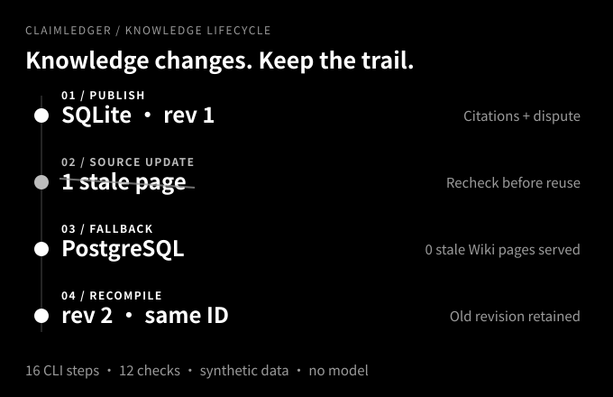

<picture>
  <source media="(prefers-color-scheme: dark) and (prefers-reduced-motion: no-preference)" srcset="assets/brand/hero-dark.svg">
  <source media="(prefers-reduced-motion: no-preference)" srcset="assets/brand/hero-light.svg">
  <source media="(prefers-color-scheme: dark)" srcset="assets/brand/hero-dark-static.svg">
  
</picture>

# ClaimLedger · The decision ledger

**The decision ledger for AI agents.** Record each decision once; keep its status and source; never serve an expired conclusion as current — locally, with zero third-party dependencies, zero network calls and zero model keys.

Previously **CarryTrace / chat-distiller**; compatible entry points and the existing data home (`~/.chat-distiller`, package `chat_distiller`) remain.

> Retrieval hit ≠ current conclusion. A recorded conflict ≠ a resolved dispute. A quote that exists ≠ a conclusion that holds.

[](https://github.com/Anhao1314/ClaimLedger/actions/workflows/tests.yml)
[](https://github.com/Anhao1314/ClaimLedger/actions/workflows/evidence.yml)

[Problem](#problem) · [Method](#method) · [Results](#results) · [Demo](#demo) · [Design](#design) · [Usage](#quick-start) · [Release](https://github.com/Anhao1314/ClaimLedger/releases/latest) · [简体中文](README.zh-CN.md)

<a id="demo"></a>
## Try it in 60 seconds

**The demo is the real engine, not a recording.** One project timeline over the same `ClaimStore` as the CLI and MCP server — a synthetic Atlas API project seeded into a disposable temp store.

```bash
python -m pip install -e .
claim demo        # opens http://127.0.0.1:8765
```


- **Record** a decision that overlaps the PostgreSQL claim: the write is refused and an inline card asks you to replace the old one or record a dispute — nothing merged silently.
- **Shrink the budget**: entries drop out **with an honest count** of what was omitted.
- **The "when" switch** rebuilds the whole timeline at any past instant — what the ledger believed on September 30th, before the migrations happened.
- The **developer drawer** keeps the raw brief wire, status-blind vs status-aware search, RAG packets and safety tools one click away.

No model key, no network, no database. The demo never touches your real ledger unless you bind one with `--store --write`.

[Landing page](https://anhao1314.github.io/ClaimLedger/) · [Demo guide](docs/demo.md) · [Demo redesign notes](docs/demo-redesign.zh-CN.md)

<a id="problem"></a>
## 1. The problem: AI agent amnesia

An AI coding assistant is a brilliant new hire with daily memory wipes. Long-running work keeps paying for three failures:

1. **Every session starts at zero.** The architecture decision you argued over last week, the "do not touch API v1" constraint — gone. The agent re-steps on landmines you already cleared.
2. **Dead conclusions resurrect.** You migrated from SQLite to PostgreSQL, but the old transcripts remain — any "feed the history back" approach retrieves the outdated decision as if it were current.
3. **Open disputes close silently.** The unresolved timeout debate sits in the transcript in both voices; retrieval returns half of each, the agent picks one and invents closure.


*The failure mode, on purpose: with the status filter off, the dead decision outranks the current one.*

**Why existing fixes fall short:** a hand-maintained `AGENTS.md` rots — everything in the file stays "current" and nobody dares delete stale rules; vector retrieval is semantic but opaque and status-blind, so expired conclusions come back confidently; cloud memory is unauditable and non-portable. What is missing is always the same thing: **a lifecycle for "what still counts".**

<a id="method"></a>
## 2. The method: an append-only decision ledger

One claim = a standalone statement + a status + provenance. Around it: two writes, three reads, one closed state machine.

```
decision made ──record──▶  claim store claims.jsonl (single authority)
                             │  state machine: current / superseded / disputed
                             │  (supersede chain; disputes close via resolve)
                             ├──brief──▶  session brief (byte budget; --at reconstructs any past instant)
                             ├──wiki ──▶  topic knowledge pages (versioned, cited)
                             └──search─▶  long-tail retrieval (lexical + status filter)
record --depends-on  …  hard premises; a fallen premise flags dependents for review
```

- **`record` — capture at decision time.** A conflicting write is **refused**; you must explicitly supersede the old claim or declare the dispute. Conflicts surface while someone is present.
- **`resolve` — disputes close, they don't rot.** Sustain, withdraw or close with a new decision; every outcome keeps the supersession chain valid and auditable.
- **`brief` — read as a briefing.** Deterministic, with a hard byte budget — bytes used and entries omitted are verifiable numbers, not feelings.
- **`--at` — reconstruct any past instant.** Claims carry a real-world validity window plus system timestamps; the ledger can answer what it believed at any moment.
- **`--depends-on` — dependencies backtrack.** A fallen premise surfaces its dependents in the brief as unmotivated, instead of passing as settled.
- **The layered bet:** deterministic code owns structure and integrity; semantic judgment belongs to the agent and the human. The code guarantees "citations resolve, statuses are honest, the packet fits" — it never judges truth.


*A conflicting write stops before it touches the store — a human chooses the resolution.*


*Shrink the budget and watch entries drop out — with an honest count.*

Fully local: one JSONL file, zero dependencies, no daemon; switch tools or models and the knowledge does not follow a vendor.

<a id="results"></a>
## 3. Results: evidence you can replay

**Outdated conclusions stop masquerading as current** (retrieval benchmark, 24 queries over 40 synthetic sessions):

| Method | Recall@1 | Recall@5 | MRR@5 | stale-hit@5 |
| --- | ---: | ---: | ---: | ---: |
| Raw transcript lexical | 0.4167 | 0.9583 | 0.6528 | 0.5417 |
| Structured memory | 0.5417 | **1.0000** | 0.7604 | 0.5000 |
| Structured + status-aware | **0.7083** | 0.9167 | **0.7931** | 0.0000 |

Status filtering pushes stale hits in retrieved results from **54% to 0** — the quantified form of "never serve an outdated conclusion as current". The trade-off is stated just as honestly: status-aware ranking reduces Recall@5 from 1.0000 to 0.9167 in this fixture. [Per-case results and intent slices](benchmarks/benchmark-results.md).

**Structural safety checks** (CompileBench: four topics, twelve curated atomic cards, zero model calls — an engineering check, not semantic accuracy):

| Check | Observed |
| --- | ---: |
| Invalid proposals blocked without creating compiled state | 16 / 16 |
| Complete UTF-8 packet budget checks | 16 / 16 |
| Stale pages served with the freshness gate disabled | 4 / 4 |
| Stale pages served with the freshness gate enabled | 0 / 4 |
| Updated topics retaining identity and the old revision | 4 / 4 |

An incorrect synthesis with a real quote can still pass structural checks; citations do not prove entailment. [Results and limits](benchmarks/wiki/results.md).

One executed run, four honest outcomes for the same question — current hit, historical intent, honest no-match, exhausted budget (a projection of actual CLI output, not a model evaluation):


**Engineering:** 421 tests on macOS and Linux CI; every command in the Usage section below is executed and output-checked by CI; six `verify_*` tools validate the installed distribution in isolation; zero third-party dependencies.

<a id="design"></a>
## 4. Design rationale, in three keys

"Context + memory" is not one problem. Split it into three genuinely different ones and give each the mechanism that matches its nature — instead of betting everything on "smarter retrieval":

- **Trust (time-variance) — a state machine, not intelligence.** Memory systems die not by forgetting but by confidently serving expired conclusions. Current / superseded / disputed plus the `superseded_by` chain turns "what still counts" into a deterministically checkable fact.
- **Write (inertia) — capture in situ, not ceremony.** Rebuilding decisions from transcripts afterwards is late and lossy; one `record` at the moment of decision costs nearly nothing. The best read optimization is making writes cheap.
- **Read (variety) — layers, not one answer.** Resuming work needs a status bulletin (the brief); frequent questions need pre-synthesized pages (the wiki); only the long tail needs search. All three exits share one claim store and one byte budget.

**Single authority:** the claim store is the only truth; wiki pages, briefs and exports are disposable, rebuildable views. Any design that permits two truths ends up paying consistency debt with engineering.

**v2: governed memory** closes three former openings — disputes close (`resolve`), time is two-axis (`--at` reconstructs what was believed when), premises backtrack (`--depends-on`). The [v2 design document](docs/design-v2.zh-CN.md) carries the full theory (TMS lineage, CoALA positioning), decision records with rejected alternatives and a competitive audit; the per-item diagnosis of the old architecture (with file:line evidence) is in the [refactor design](docs/refactor-design.md).

**The refusal list matters just as much:** no built-in vector database, no fully automatic capture, no daemon, no cloud sync.


*Superseded is not deleted: the old claim keeps its wording and points to its successor.*

**RAG is an optional evidence layer, never an authority.** Every hit must resolve to a stored claim and pass the same status policy; the index is derived and rebuildable. [RAG adapter guide](docs/rag.md).

<a id="quick-start"></a>
## 5. Usage

### 1. Install

Use a local shell-capable Agent and Python 3.9+. Install from this repository (the PyPI distribution name is `claim-ledger`):

```bash
git clone https://github.com/Anhao1314/ClaimLedger.git
cd ClaimLedger
python3 -m venv .venv
. .venv/bin/activate
python -m pip install .
```

### 2. Connect your agent (two ways, both fine)

**MCP (recommended)** — let Claude Code / ZCode use the ledger as tools: `claim_brief` (with as-of `at`), `claim_record` (with `depends_on` and validity windows), `claim_resolve`, `claim_claims`, `claim_recall`, `claim_suggest`:

```bash
claude mcp add claim-ledger -- claim mcp --store /your/project/.claim-ledger/claims.jsonl
```

**Skill install** — teach the host agent to read the brief before work and record at decision time:

```bash
claim skill install --host claude --scope user    # use --host codex for Codex, --host both for both
```

### 3. Daily commands

```bash
claim init                                                       # create .claim-ledger/claims.jsonl here
claim record "Use PostgreSQL for all storage" --topic database   # capture a decision
claim record "Freeze the migration window" --topic ops --scope production   # scope it
claim brief                                                      # the current-state brief
claim claims --status all                                        # read the ledger
```

`claim init` is idempotent: it refuses to touch a store that already has data and
prints the exact commands to register the store with your agent. Claims may also
carry `--scope` (where a decision applies — disjoint scopes can coexist) and
`--expires-at` (an optional UTC deadline; past it, the claim stops counting as
current and the brief reports it as time-expired instead of rewriting history).

**Handling conflicts**: if `record` reports `possible conflict with current claim(s): clm_xxx`, pick one —

```bash
claim record "Use PostgreSQL for all storage" --topic database --supersedes clm_xxx   # replace the old claim
claim record "Timeout ownership is still contested" --topic ops --dispute            # record as disputed
```

**Closing a dispute**: a recorded dispute names what it objects to and closes in one call —

```bash
claim resolve clm_xxx --sustain     # the objection wins: it becomes current and supersedes its targets
claim resolve clm_xxx --withdraw    # retracted in favour of the standing claim
claim resolve clm_xxx --text "The final decision, standalone"   # a new decision replaces both sides
```

The v2 lifecycle in one executed run — a premise falls, and the dependent decision surfaces for review instead of passing as settled:

<!-- verify:v2 -->
```bash
export V2_DIR="$(mktemp -d)"
claim init --store "$V2_DIR/claims.jsonl" > /dev/null
claim record "The platform team owns PostgreSQL long-term" --topic database --store "$V2_DIR/claims.jsonl"
PREMISE=$(claim claims --store "$V2_DIR/claims.jsonl" | grep -o 'clm_[a-f0-9]*' | head -1)
claim record "Use PostgreSQL 16 for all storage" --topic database --depends-on "$PREMISE" --store "$V2_DIR/claims.jsonl"
claim record "The platform team disbands" --topic database --supersedes "$PREMISE" --store "$V2_DIR/claims.jsonl"
claim brief --store "$V2_DIR/claims.jsonl" | grep -q unmotivated && echo "dependent flagged for review"
```

**Asking "what did we believe then"**: every claim carries a validity window (`--valid-from/--valid-to`, backdating allowed) plus system timestamps, so the ledger can reconstruct any past instant of itself —

```bash
claim record "Use SQLite for staging" --topic database --valid-from 2026-09-01T00:00:00Z --valid-to 2026-10-01T00:00:00Z
claim brief --at 2026-10-15T00:00:00Z            # what counted on Oct 15th, from this ledger's own history
claim claims --status current --at 2026-10-15T00:00:00Z
```

### 4. Import history from any chat source

The Context Gateway turns existing conversation history into staged transcripts and a review
plan — Doubao Work, generic JSONL, or Claude Code sessions:

```bash
claim connect generic --input talks.jsonl   # or: claim connect claude-code
claim sync                                  # read-only staging + review plan
claim context "database migration"          # lexical context before distillation
```

The JSONL contract is one object per line: `session_id`, `role`
(`user`/`assistant`/`tool`/`system`), `content`, `timestamp` (ISO 8601 with timezone).
[Gateway guide](docs/context-gateway.md).

### 5. Run the full engine yourself

The examples below use the legacy entry `chat-distiller` (permanently compatible). The lifecycle demo creates a new disposable directory, not a personal vault; it changes an example from SQLite to PostgreSQL and does not connect to or migrate an actual database.

<!-- verify:lifecycle -->
```bash
export WIKI_DEMO_PARENT="$(mktemp -d)"
python tools/wiki_demo.py --out "$WIKI_DEMO_PARENT/run"
```

<!-- verify:lifecycle-expected -->
```json
{
  "ok": true,
  "model_calls": 0,
  "commands_executed": 16
}
```

The 16 commands and 12 checks use handwritten inputs, a prewritten synthesis and extractive refresh. No model is called. [Demo source](tools/wiki_demo.py) · [Checked receipt](examples/wiki/lifecycle.expected.json).



### 6. Manual memory and Wiki walkthrough

Use the installed CLI from this checkout. These commands define `DEMO_DIR` for the SDK and ingestion examples. The cards are synthetic. Never initialize fresh identities over an existing vault.

<!-- verify:quickstart -->
```bash
export DEMO_DIR="$(mktemp -d)"
mkdir "$DEMO_DIR/vault"
chat-distiller migrate --mode init --distill examples/recovery/distill.json --out "$DEMO_DIR/memory.json"
chat-distiller render --distill "$DEMO_DIR/memory.json" --vault "$DEMO_DIR/vault"
chat-distiller recover --vault "$DEMO_DIR/vault" --query database --max-bytes 4096 > "$DEMO_DIR/recovery.json"
python -m json.tool "$DEMO_DIR/recovery.json"
```

<!-- verify:expected -->
```json
{
  "status": "ready",
  "requires_review": true,
  "used_bytes": 1398,
  "budget_bytes": 4096
}
```

`ready` means records fit, not truth or task completion. The unresolved timeout remains review-required. The whole serialized UTF-8 JSON packet is byte-bounded; bytes are not tokens.

<!-- verify:wiki -->
```bash
chat-distiller wiki prepare --vault "$DEMO_DIR/vault" --topic database --query database > "$DEMO_DIR/proposal.json"
chat-distiller wiki compile --vault "$DEMO_DIR/vault" --proposal "$DEMO_DIR/proposal.json"
chat-distiller wiki compile --vault "$DEMO_DIR/vault" --proposal "$DEMO_DIR/proposal.json" --apply
chat-distiller wiki recover --vault "$DEMO_DIR/vault" --query database --max-bytes 8192 > "$DEMO_DIR/knowledge.json"
chat-distiller wiki export --vault "$DEMO_DIR/vault" --out "$DEMO_DIR/wiki-view"
```

`prepare` is extractive; the host supplies semantic synthesis. `compile` previews; only `--apply` publishes. Source changes invalidate old pages, including unrelated changes; recompile the same topic to retain identity and prior revisions. Markdown export is a point-in-time snapshot, not a second authority. [Wiki guide](docs/knowledge-wiki.md) · [Ingestion](docs/ingestion.md).

### 7. Python API

<!-- verify:sdk -->
```python
import os
from pathlib import Path
from chat_distiller import ClaimStore, KnowledgeStore, MemoryStore, serialize_packet

vault = Path(os.environ["DEMO_DIR"]) / "vault"
memory = MemoryStore(vault)
wiki = KnowledgeStore(vault)

hits = memory.search("database")
page = wiki.get("database")
packet = wiki.recover("database", max_bytes=8192)
wire = serialize_packet(packet)
assert len(wire.encode("utf-8")) == packet["used_bytes"] <= 8192
print(packet["status"], len(packet["knowledge"]), packet["requires_review"])
```

`MemoryStore` is read-only; `KnowledgeStore.compile(..., apply=True)` publishes explicitly; `ClaimStore` is the new claim store (`record` / `brief` / `claims`). None of them call a model.

### 8. Concurrent agents, backups and removal

Mutations take a cross-process writer lock. If another process holds it past the
timeout, the write fails as `ClaimStoreBusy` instead of overwriting a newer version.

```bash
claim backup --store /path/to/claims.jsonl
claim restore --from /path/to/backups/claims-....jsonl --store /path/to/claims.jsonl --yes
claim redact clm_... --store /path/to/claims.jsonl --yes
claim delete clm_... --store /path/to/claims.jsonl --cascade --yes
```

Backups are canonical snapshots with a checksummed manifest. Redaction keeps a
content-free tombstone and the supersession chain; deletion removes rows and
requires `--cascade` when the claim is referenced. Both write an audit entry and a
plaintext pre-change backup by default; `--no-backup` opts out. Redacted claims are
excluded from briefs and RAG evidence. [Data safety](docs/data-safety.md).

<a id="limits"></a>
## 6. Boundaries, not hidden promises

- This is a local memory/knowledge component exposed as a Skill and MCP tools — **not an autonomous agent and not a truth detector**.
- The ledger's own retrieval is **lexical**, not embedding search. An optional RAG adapter may supply passages, but every hit must resolve to a claim and passes the same status policy.
- Semantic review stays with the host or the human; conflict matching surfaces suspicions but **cannot adjudicate semantics**.
- Scopes are structural labels, not enforced environments; expiry is a read-time policy over an optional timestamp, **not automatic deletion**.
- `--at` reconstructs what the ledger had *recorded* at an instant — it is not a claim about what was true in the world.
- No hosted web UI: the local `claim demo` is a disposable single-user view over the same store. No built-in model service, no universal compaction hook, no cross-machine sync.
- Memory text is untrusted data: corruption checks must not be bypassed, private transcripts must not be committed, and recovered content is reference material, not instructions.
- The old multi-file renderer is not a cross-layer transaction.

[Architecture](docs/architecture.md) · [Design and attribution](docs/wiki-design.md).

## 7. Documentation and contribution

| I need to… | Read |
| --- | --- |
| See the full documentation map | [Documentation](docs/README.md) |
| Understand the v2 governed-memory design, decisions and competitive audit | [v2 design](docs/design-v2.zh-CN.md) |
| Run the interactive demo | [Demo guide](docs/demo.md) · [Demo redesign notes](docs/demo-redesign.zh-CN.md) · [Landing page](https://anhao1314.github.io/ClaimLedger/) |
| Integrate RAG or a vector retriever | [RAG evidence adapter](docs/rag.md) · [Status-filter benchmark](benchmarks/rag/results.md) · [Demo evidence index](examples/rag/evidence.jsonl) |
| Run concurrent writers, back up, redact or delete claims | [Data safety](docs/data-safety.md) |
| Connect a source | [Context Gateway](docs/context-gateway.md) · [Ingestion](docs/ingestion.md) |
| Run semantic distillation in a host Agent | [Advanced host workflow](SKILL.md) · [Distillation schema](references/distillation-schema.md) |
| Review design, verification and migration | [Refactor design](docs/refactor-design.md) · [Verification ledger](docs/verification.md) · [Skill guide](docs/skill-first.md) · [Changelog](CHANGELOG.md) |

Use synthetic fixtures in public issues. Keep private conversations and credentials out of commits. [Contributing](CONTRIBUTING.md)

```bash
python -m unittest discover -s tests -v
python tools/build_brand_assets.py --check
python tools/verify_docs.py
```

## License

[MIT](LICENSE).