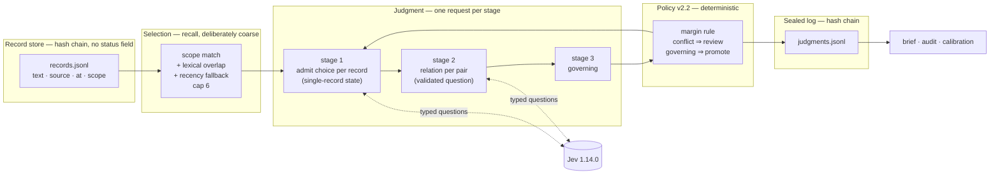
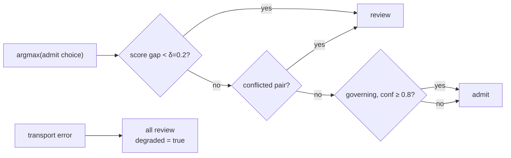
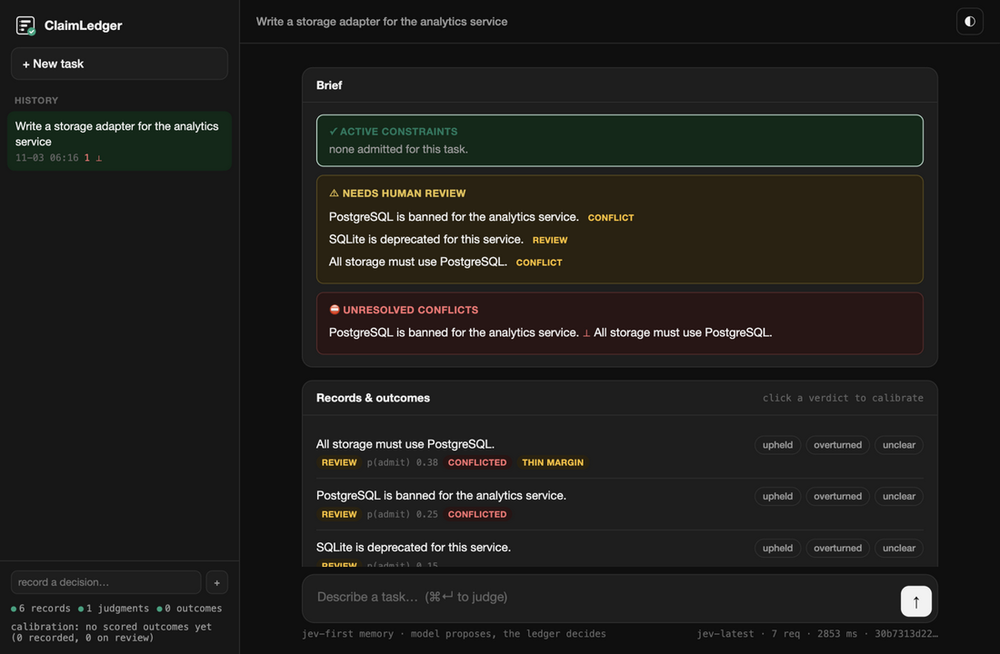
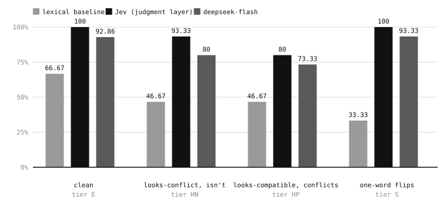
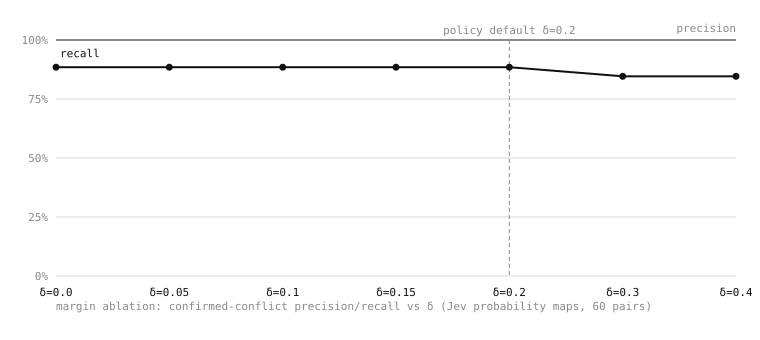

<p align="center">
  
</p>

# ClaimLedger · a Jev-first memory layer for agents

> **Status (2026-11) — an engineering artifact, not a research contribution.**
> This repository's founding question — do agents act on superseded conclusions, and does
> status filtering prevent it — was answered before this repository existed, with stronger
> evidence: *Revoked but Still Authoritative* ([arXiv:2609.08258](https://arxiv.org/abs/2609.08258),
> Sep 2026) tested 5 memory systems × 9 models × 9 policy scenarios and found that **no system
> enforces revocation by default**. The governed-memory design space is covered by
> [GPM](https://arxiv.org/abs/2608.12476), [MemTX](https://arxiv.org/abs/2607.23929) and
> [PLACE](https://arxiv.org/abs/2610.25179).
>
> What remains here is a small, dependency-free implementation with one unusual property:
> **the model does not own judgment — a frozen question set, a deterministic policy, and a
> sealed decision log do.** The generation model can be swapped without touching any of them.
> [Why the research framing was withdrawn](docs/DECISION.md) ·
> [the literature check](docs/prior-art.md) · [why Jev sits at the center](docs/JEV-FIRST.md)

**What it does:** an agent writes decisions into an append-only, hash-chained record store.
For each task, a candidate selector picks ≤6 records; a judgment engine asks the
[TypeSafe Jev](https://docs.typesafe.ai/introduction) System One model a frozen set of typed
questions (one `admit` choice per record, pairwise `relation` for conflict localization,
`governing`); a deterministic policy turns probabilities into actions; a sealed log makes every
decision auditable and every probability calibratable against human outcomes.

## Architecture

The whole decision path. Dashed edge: not wired (the store is read directly by the CLI, but
candidate selection is deterministic — no model at the entrance).



The policy state machine (every path ends in a human-readable action; no path ends in a
silent suppression):



## How it works — the daily loop

Three roles, one cycle:

| Role | What they do | How |
| --- | --- | --- |
| **Your agent** (Claude / Cursor / ZCode) | Records decisions as they happen; queries constraints before starting work | MCP tools (`memory_record`, `memory_decide`, `memory_brief`) |
| **You** (developer) | Reviews outcomes: was the agent's judgment right? | Console or CLI (`outcome`) |
| **The system** | Tracks how well its own judgments match reality | Calibration view (`calibrate`) |

### The core loop

```
 Agent does work
       │
       ▼
 memory_decide(task)          ← "which constraints apply right now?"
       │
       ▼
 ┌─ Brief returned to the agent ──────────────────────────┐
 │ ✓ ACTIVE: All storage must use PostgreSQL.              │  → agent follows
 │ ⚠ REVIEW: banned for analytics  ⟂ all-PostgreSQL        │  → held for human
 └────────────────────────────────────────────────────────┘
       │
       ▼
 Agent writes code — but avoids the conflicted territory
       │
       ▼
 Human opens console → clicks upheld / overturned
       │
       ▼
 Calibration data grows → thresholds become evidence-backed
```

### What happens when you swap models

```
 Before (Claude):   records → judge(old model) → action
 After (DeepSeek):  records → judge(new model) → action
                             ↑
                   records unchanged (no status field)
                   question set unchanged (contract v1, sha256 frozen)
                   policy unchanged (v2.2)
                   the only thing that changed: the generation model
```

Old judgments and new judgments are directly comparable — every judgment carries its model
version and full probability distribution. The cross-model replay already showed **29/29
label agreement** between Jev and DeepSeek on the frozen pairs.

## Quick start

A live decision on a 10-record store — one command, no other steps:

```text
$ python -m jev_first decide --store records.jsonl \
    --task "Write a storage adapter for the analytics service"

selection: total 10 → lexical_hits 3 → selected 3, omitted 7
requests 7 (3 admit + 3 pair + 1 governing)   latency 3280 ms
conflicts: [["All storage must use PostgreSQL.",
             "PostgreSQL is banned for the analytics service."]]
record                    action   p(admit)  gov  cf   in
rec_f66f…  review  0.35  yes  yes  yes
rec_af79…  review  0.30  yes  yes  yes
rec_22b7…  review  0.10           yes
bytes 216/2048   omitted 0
sealed: 83d35c649f37df31…  prev 0000000000000000…
```

The two conflicting records were pulled in by selection, caught by stage 2, and
held for human review — nothing was silently admitted or silently dropped.

### Console

The same flow, in a local web console (dark mode, with outcome collection):



```bash
python -m jev_first console --store records.jsonl
# → http://127.0.0.1:8766
```

```bash
python -m pip install .
python -m jev_first record --store records.jsonl --text "All storage must use PostgreSQL." --source agent
python -m jev_first decide --store records.jsonl --task "Write a storage adapter for analytics"
python -m jev_first brief  --store records.jsonl --task "Write a storage adapter for analytics"
python -m jev_first verify --store records.jsonl
```

Zero third-party dependencies, Python 3.9+. Records carry no status field: validity is a
judgment, not a datum. The brief separates what the agent may rely on (`admit`) from what
needs a human (`review` — conflicted, thin margin, or hedged).

## MCP server

```bash
export TYPESAFE_API_KEY=…   # without it the server answers in degraded mode
python -m jev_first.mcp_server --dir ~/.jev-memory
```

Six tools: `memory_record`, `memory_decide`, `memory_brief`, `memory_outcome`,
`memory_calibrate`, `memory_audit`. Tool failures come back as `isError` results; the server
never crashes on a tool. Without a key, decide/brief answer degraded — every record review.

## Results

### 1. Adversarial benchmark — the judgment layer vs lexical overlap

60 statement pairs in four tiers, three methods. The lexical baseline exists to prove the
benchmark bites: it collapses exactly where word overlap stops predicting meaning.



| Tier | Tests | Lexical | Jev | deepseek-flash |
| --- | --- | ---: | ---: | ---: |
| E — clean | floor ability | 0.667 | **1.000** | 0.929 |
| HN — looks-conflict, isn't | scope carve-outs, unit conversion, same-fact | 0.467 | **0.933** | 0.800 |
| HP — looks-compatible, conflicts | synonym negation, unit drift, implicit deps | 0.467 | 0.800 | 0.733 |
| S — one-word flips | sensitivity triples | 0.333 | **1.000** | 0.933 |
| **All** | | **0.483** | **0.933** | **0.847** |

The advantage concentrates on the adversarial tiers (+47pp over lexical on HN) — the same
class of error that motivated the project. Jev's three HP misses are all numeric/implicit
reasoning (unit conversion, count comparison, version dependency), recorded as the next
question-set iteration.

### 2. Margin ablation — why δ=0.2

A 5×5 stability check caught the judgment model flipping a borderline pair once in six runs
while unambiguous pairs never flip. Argmax alone lets that noise become a decision, so the
policy requires a gap between the top-two options. The ablation sets the threshold:



Precision holds at 1.0 through δ=0.2 and recall is flat; at δ≥0.3 recall drops with no
precision gain. **The constant sits at the end of the plateau — measured, not chosen.**

### 3. Cross-model portability

Same frozen contract, two model families: **29/29 label agreement** between Jev 1.14.0 and
DeepSeek-V4.1-Flash on the comparable pairs, 30/30 vs the frozen labels for DeepSeek.
Sensitivity-triple consistency: Jev 1.0, DeepSeek 0.8.

| Experiment | Result | Artifact |
| --- | --- | --- |
| Relation judgment (30 frozen pairs) | contradiction recall 10/10, false suppression 0/20 — **PASS** | [jev_relation_001](experiments/jev_relation_001/README.md) |
| Cross-model replay (Jev vs DeepSeek) | **29/29 label agreement** on comparable pairs | [crossmodel](experiments/jev_relation_001/crossmodel-deepseek-flash.json) |
| Borderline stability (5×5) | ambiguous pairs flip, unambiguous never → **margin rule** | [borderline-stability](experiments/jev_relation_001/borderline-stability.json) |
| Adversarial benchmark (60 pairs, 3 methods) | Jev 0.933 vs lexical 0.483 — **discriminating gate PASS** | [relation_002](experiments/relation_002/results.json) |
| Constraint delivery (premise_001 v1.1) | memory-layer delivery **non-inferior** to prompt delivery | [premise_001](experiments/premise_001/results.json) |

Known limitation, recorded honestly: the candidate selector is lexical, so a record with zero
token overlap is not selected. Semantic recall is deferred to a topic field (contract v2).

## What was withdrawn and why

The original framing — a novel "decision ledger" — was withdrawn after a two-hour literature
check found the space occupied ([review](docs/prior-art.md)); the demo, landing site, wiki, RAG
adapter and brand assets built around it were removed in the cleanup. What was kept is the
part the checks could not kill: an auditable judgment layer with an honest boundary.

| Doc | Content |
| --- | --- |
| [docs/architecture.md](docs/architecture.md) | current architecture + policy state machine |
| [docs/JEV-FIRST.md](docs/JEV-FIRST.md) | why the model owns judgment; the cut list |
| [docs/DECISION.md](docs/DECISION.md) | the withdrawn claim, recorded |
| [docs/prior-art.md](docs/prior-art.md) | the literature check |
| [docs/jev.md](docs/jev.md) | the Jev adapter: contract, measured latency, privacy boundary |
| [docs/design-v2.zh-CN.md](docs/design-v2.zh-CN.md) | legacy design record (pre-inversion) |

## Boundaries

- This is a local memory/judgment component — **not an autonomous agent and not a truth detector**.
- The Jev adapter is the only network path; it requires explicit consent and sends the judged
  text to a third party. Records never leave the machine otherwise.
- Calibration v1 scores `admit` entries only; `review`/`exclude` outcomes are recorded but not
  yet scored.
- The candidate selector is lexical; a record with zero token overlap is not selected.
- No web UI, no daemon, no cross-machine sync.

[MIT](LICENSE)