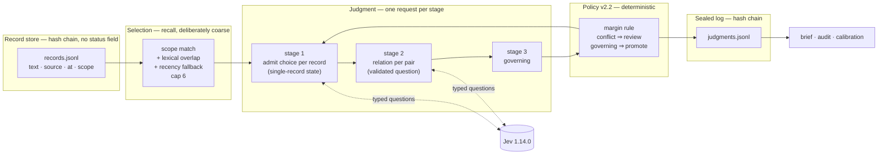
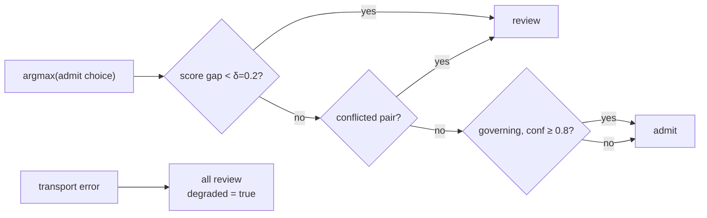
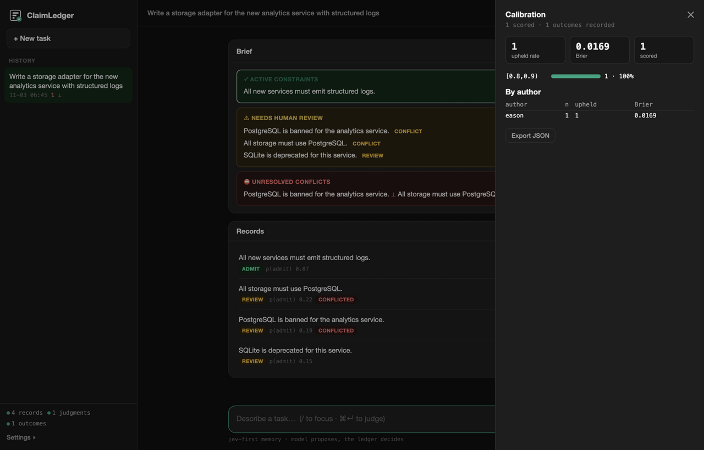
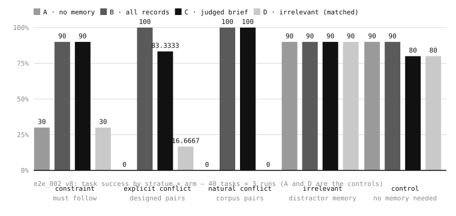

<p align="center">
  
</p>

<h1 align="center">ClaimLedger</h1>

<p align="center">
  <strong>Agent memory governance: the model proposes, the ledger decides.</strong><br>
  <span style="color:#6b6b6b">A Jev-first memory layer — frozen typed questions, deterministic policy, a sealed judgment log.</span>
</p>

> **Status (2026-11) — an engineering artifact, not a research contribution.**
> This repository's founding question — do agents act on superseded conclusions, and does
> status filtering prevent it — was answered before this repository existed, with stronger
> evidence: *Revoked but Still Authoritative* ([arXiv:2609.08258](https://arxiv.org/abs/2609.08258),
> Sep 2026) tested 5 memory systems × 9 models × 9 policy scenarios and found that **no system
> enforces revocation by default**. The governed-memory design space is covered by
> [GPM](https://arxiv.org/abs/2608.12476), [MemTX](https://arxiv.org/abs/2607.23929) and
> [PLACE](https://arxiv.org/abs/2610.25179).
>
> What remains here is a small, dependency-free implementation with one unusual property:
> **the model does not own judgment — a frozen question set, a deterministic policy, and a
> sealed decision log do.** The generation model can be swapped without touching any of them.
> [Why the research framing was withdrawn](docs/DECISION.md) ·
> [the literature check](docs/prior-art.md) · [why Jev sits at the center](docs/JEV-FIRST.md)

## Why I built this

Every AI coding agent I used had the same failure mode: **each new session started from
zero.** The architecture decision I argued over last week, the "do not touch API v1"
constraint, the migration we reverted — all gone. I tried CLAUDE.md, tried mem0, tried
manually maintaining a constraints file. Each had its own failure mode:

- CLAUDE.md constraints silently contradict and silently expire
- mem0 retrieves by embedding similarity — a superseded conclusion returns as confidently
  as a current one
- Manual maintenance doesn't scale past ~20 constraints

What was missing wasn't another memory system — it was **a layer that judges what still
counts.** Not "what is similar" (that's retrieval), not "what was decided" (that's logging),
but "what constraints still apply to the task I'm about to do, and which ones conflict."

I built this layer, discovered my initial research framing was already covered by prior
art, withdrew the claim, and kept the engineering. This repository is the result.

**What it does:** an agent writes decisions into an append-only, hash-chained record store.
For each task, a candidate selector picks ≤6 records; a judgment engine asks the
[TypeSafe Jev](https://docs.typesafe.ai/introduction) System One model a frozen set of typed
questions (one `admit` choice per record, pairwise `relation` for conflict localization,
`governing`); a deterministic policy turns probabilities into actions; a sealed log makes every
decision auditable and every probability calibratable against human outcomes.

## Architecture

The whole decision path. Dashed edge: not wired (the store is read directly by the CLI, but
candidate selection is deterministic — no model at the entrance).



The policy state machine (every path ends in a human-readable action; no path ends in a
silent suppression):



## How it works — the daily loop

Three roles, one cycle:

| Role | What they do | How |
| --- | --- | --- |
| **Your agent** (Claude / Cursor / ZCode) | Proposes decisions as they happen; queries constraints before starting work | MCP tools (`memory_propose`, `memory_decide`, `memory_brief`) — proposals wait for you |
| **You** (developer) | Confirms or rejects agent proposals; reviews outcomes: was the agent's judgment right? | Console (Proposals panel) or CLI (`confirm` / `reject` / `outcome`) |
| **The system** | Tracks how well its own judgments match reality — overall, per model, and per record author | Calibration view (`calibrate --store …`) |

### The core loop

```
 Agent does work
       │
       ▼
 memory_decide(task)          ← "which constraints apply right now?"
       │
       ▼
 ┌─ Brief returned to the agent ──────────────────────────┐
 │ ✓ ACTIVE: All storage must use PostgreSQL.              │  → agent follows
 │ ⚠ REVIEW: banned for analytics  ⟂ all-PostgreSQL        │  → held for human
 └────────────────────────────────────────────────────────┘
       │
       ▼
 Agent writes code — but avoids the conflicted territory
       │
       ▼
 Human opens console → clicks upheld / overturned
       │
       ▼
 Calibration data grows → thresholds become evidence-backed
```

### What happens when you swap models

```
 Before (Claude):   records → judge(old model) → action
 After (DeepSeek):  records → judge(new model) → action
                             ↑
                   records unchanged (no status field)
                   question set unchanged (contract v1, sha256 frozen)
                   policy unchanged (v2.2)
                   the only thing that changed: the generation model
```

Old judgments and new judgments are directly comparable — every judgment carries its model
version and full probability distribution. The cross-model replay already showed **29/29
label agreement** between Jev and DeepSeek on the frozen pairs.

### When you need this — and when you don't

Honest scaling assessment. This layer earns its complexity at a specific project size; below
that, a `CLAUDE.md` file is simpler and better.

| | CLAUDE.md | ClaimLedger |
| --- | --- | --- |
| Setup | open a file and write | install + MCP + agent instructions |
| Latency | **0ms** (always in context) | 1–5 s per judgment (Jev call) |
| Reliability | **100%** (the model cannot miss it) | depends on the agent calling `memory_decide` |
| Dependencies | none | TypeSafe key + network |
| Conflict detection | none — contradictions pass silently | pairwise localization → held for review |
| Stale-constraint handling | none — expired rules stay forever | re-judged on every `decide` call |
| Calibration | impossible | per-bucket upheld rate + Brier score |
| Scale ceiling | ~20 constraints before context bloats | designed for 50+ (untested at scale) |

**Small projects (< 20 constraints): use CLAUDE.md.** It is simpler, faster, always in
context, and has no external dependency. This layer adds complexity without benefit at
this scale.

**Large projects (50+ constraints, changing requirements): this is where a judgment layer
earns its keep.** CLAUDE.md constraints silently contradict and silently expire. This layer
catches both. But this advantage is currently theoretical — no real project at this scale
has been measured.

**Multi-agent teams:** structurally necessary (agents writing conflicting memories need a
shared authority), but the merge semantics are not built yet.

## Positioning

How this layer compares to tools developers actually use:

| | mem0 | Letta / MemGPT | Zep / Graphiti | **ClaimLedger** |
| --- | --- | --- | --- | --- |
| Core capability | fact extraction + vector retrieval | stateful agent runtime | temporal knowledge graph | **governance: what still counts** |
| Judgment layer | none (embedding similarity) | none (LLM self-judgment) | none (edge invalidation) | **typed questions + calibrated probability** |
| Conflict handling | silent merge | none | edge invalidation only | **pairwise localization → review** |
| Auditability | retrieval log | conversation history | provenance graph | **sealed judgment log + hash chain** |
| Model-independent | yes (retrieval) | no (memory format tied to model) | yes (graph) | **yes (question set + policy are frozen)** |
| Calibration | none | none | none | **per-bucket upheld rate + Brier** |
| Dependencies | several | several | several | **zero** |

**The layer this occupies:** every system above answers "what was decided and what does it
look like now." None of them answers **"is that decision still valid, and how confident am I
in that answer?"** — which is the question that matters when the generation model changes.

## Operations

Two incidents from real usage, recorded because they shaped the design:

**Incident 1 — TypeSafe API region block (HTTP 451).** The judgment provider became
unreachable mid-session. Every `memory_decide` call failed. The fail-open semantics
designed into the policy held: all records went to review, nothing was silently admitted
or excluded. **Lesson: an outage must never look like a confident exclusion.** The
transport abstraction (`caller` parameter + `TYPESAFE_URL` env) allows switching to a
proxy without code changes.

**Incident 2 — borderline sampling flip (~17%).** The judgment model flipped a
complementary pair to contradiction once in six runs, while unambiguous pairs never
flipped. A single observation was initially reported as a cross-model disagreement; a
5×5 stability check refuted it. **Lesson: argmax without a margin rule lets sampling
noise become a decision.** Policy v2.2 added the margin rule; the ablation that
validated δ=0.2 is committed alongside the code.

## Quick start

A live decision on a 10-record store — one command, no other steps:

```text
$ python -m jev_first decide --store records.jsonl \
    --task "Write a storage adapter for the analytics service"

selection: total 10 → lexical_hits 3 → selected 3, omitted 7
requests 7 (3 admit + 3 pair + 1 governing)   latency 3280 ms
conflicts: [["All storage must use PostgreSQL.",
             "PostgreSQL is banned for the analytics service."]]
record                    action   p(admit)  gov  cf   in
rec_f66f…  review  0.35  yes  yes  yes
rec_af79…  review  0.30  yes  yes  yes
rec_22b7…  review  0.10           yes
bytes 216/2048   omitted 0
sealed: 83d35c649f37df31…  prev 0000000000000000…
```

The two conflicting records were pulled in by selection, caught by stage 2, and
held for human review — nothing was silently admitted or silently dropped.

### Console

The same flow, in a local web console (dark mode). One input does tasks; the
brief, the per-record verdicts, and the conflict localization are on one canvas.
Clicking a record opens its judgment history, and every outcome click says
whether it moves calibration (`scoreable: 1 of 4` here).


The calibration slide-over joins upheld / overturned outcomes to the admitted
records that predicted them — overall, per probability bucket, and per author.
v1 scores `admit` entries only, and says so where the user clicks:



Agent writes do not land on the canvas directly: they arrive in the topbar's
**Proposals** panel with the proposer's identity, and become records only after
you press Confirm. Reject leaves the record store untouched.

```bash
python -m jev_first console --store records.jsonl
# → http://127.0.0.1:8766
```

```bash
python -m pip install .
python -m jev_first record --store records.jsonl --text "All storage must use PostgreSQL." --source agent
python -m jev_first decide --store records.jsonl --task "Write a storage adapter for analytics"
python -m jev_first brief  --store records.jsonl --task "Write a storage adapter for analytics"
python -m jev_first verify --store records.jsonl
```

Zero third-party dependencies, Python 3.9+. Records carry no status field: validity is a
judgment, not a datum. The brief separates what the agent may rely on (`admit`) from what
needs a human (`review` — conflicted, thin margin, or hedged). When lexical recall finds no
match, the brief says `NO RELEVANT RECORDS` instead of presenting recency-selected noise as
a constraint.

Writes are content-addressed and paraphrase-aware: exact repeats are refused, and a
near-identical decision from another agent returns the existing record with
`created: false` instead of appending a duplicate. The check is deterministic (token
containment + Jaccard, with a negation guard), so it needs no model call at write time.
Console and CLI writes append directly — the human is the confirmer; agent writes via MCP
land in the proposal log first.

## MCP server

```bash
export TYPESAFE_API_KEY=…   # without it the server answers in degraded mode
python -m jev_first.mcp_server --dir ~/.jev-memory
```

Seven tools: `memory_propose` (plus `memory_record` as a deprecated alias),
`memory_decide`, `memory_brief`, `memory_calibrate`, `memory_audit`,
`memory_proposals`. `decide` and `brief` both seal the judgment to the
hash-chained log and return `judgment_hash`; a human records the outcome against
that hash in the console or CLI. Tool failures come back as `isError` results; the
server never crashes on a tool. Without a key, decide/brief answer degraded — every record
review.

Agent writes are **proposals, not records**. `memory_propose` returns
`status: pending` and a `proposal_id`; the decision is not active memory until a
human confirms it in the console's Proposals panel or with `jev_first confirm`.
There is deliberately no confirm tool on the MCP server: an agent that could
confirm its own write would have no gate at all. The proposal log is
hash-chained and records both the proposal and the human decision.

**Outcome is human-only too.** There is no `memory_outcome` on the MCP server:
calibration's ground truth is the one input an agent must not be able to write.
Verdicts are recorded from the console or `jev_first outcome`.

**The tools do nothing until the agent is told to call them.** Copy the block from
[docs/agent-instructions.md](docs/agent-instructions.md) into your `CLAUDE.md` / `AGENTS.md`
and register the server; without it the layer is invisible to the agent.
[Two-week protocol](docs/agent-instructions.md#two-week-protocol) is included.

## Results

### 1. Adversarial benchmark — the judgment layer vs lexical overlap

60 statement pairs in four tiers, three methods. The lexical baseline exists to prove the
benchmark bites: it collapses exactly where word overlap stops predicting meaning.


| Tier | Tests | Lexical | Jev | deepseek-flash |
| --- | --- | ---: | ---: | ---: |
| E — clean | floor ability | 0.667 | **1.000** | 0.929 |
| HN — looks-conflict, isn't | scope carve-outs, unit conversion, same-fact | 0.467 | **0.933** | 0.800 |
| HP — looks-compatible, conflicts | synonym negation, unit drift, implicit deps | 0.467 | 0.800 | 0.733 |
| S — one-word flips | sensitivity triples | 0.333 | **1.000** | 0.933 |
| **All** | | **0.483** | **0.933** | **0.847** |

The advantage concentrates on the adversarial tiers (+47pp over lexical on HN) — the same
class of error that motivated the project. Jev's three HP misses are all numeric/implicit
reasoning (unit conversion, count comparison, version dependency), recorded as the next
question-set iteration.

### 2. Margin ablation — why δ=0.2

A 5×5 stability check caught the judgment model flipping a borderline pair once in six runs
while unambiguous pairs never flip. Argmax alone lets that noise become a decision, so the
policy requires a gap between the top-two options. The ablation sets the threshold:


Precision holds at 1.0 through δ=0.2 and recall is flat; at δ≥0.3 recall drops with no
precision gain. **The constant sits at the end of the plateau — measured, not chosen.**

### 3. Cross-model portability

Same frozen contract, two model families: **29/29 label agreement** between Jev 1.14.0 and
DeepSeek-V4.1-Flash on the comparable pairs, 30/30 vs the frozen labels for DeepSeek.
Sensitivity-triple consistency: Jev 1.0, DeepSeek 0.8.

### 4. Is the judge a commodity? — five axes, not one

Accuracy alone cannot justify a judge choice. The same 60 pairs through three judges, same
question, repeated runs:

| Judge | Accuracy | Genuine flips | Parse failures | Brier | p50 latency |
| --- | ---: | ---: | ---: | ---: | ---: |
| **Jev 1.14.0** | 0.933 | **0/60** | **0.67%** | 0.046 | **945 ms** |
| deepseek-flash (t=1.0) | 0.927 | 7/60 | 14.0% | **0.025** | 2,124 ms |
| deepseek-v4-pro (t=1.0) | 0.973* | 2/60 | 40.0% | 0.0† | 3,916 ms |

\* v4-pro's accuracy is computed only over the 60% of calls that produced a parseable
distribution. † Its 0.0 Brier is degenerate output (top probability ≥ 0.99 on 100% of parsed
responses), not calibration.

**The honest read:** accuracy is roughly a tie between Jev and a general LLM judge; **Jev does
not win the calibration axis** (flash's Brier is lower, though it is more overconfident and
bails on the 14% hardest calls). What Jev does win decisively is **stability** (zero genuine
label changes in 300 calls vs 11.7% of pairs flipping for flash) and **schema reliability**
(99.3% valid typed output vs 86% and 60%). Those are the two properties a governance layer
cannot work without.

The architecture claim survives either way: three different judges ran through the same
question set, and every difference is measurable at the output. [Full analysis](experiments/judge_bench_001/results.md).

| Experiment | Result | Artifact |
| --- | --- | --- |
| Relation judgment (30 frozen pairs) | contradiction recall 10/10, false suppression 0/20 — **PASS** | [jev_relation_001](experiments/jev_relation_001/README.md) |
| Cross-model replay (Jev vs DeepSeek) | **29/29 label agreement** on comparable pairs | [crossmodel](experiments/jev_relation_001/crossmodel-deepseek-flash.json) |
| Borderline stability (5×5) | ambiguous pairs flip, unambiguous never → **margin rule** | [borderline-stability](experiments/jev_relation_001/borderline-stability.json) |
| Adversarial benchmark (60 pairs, 3 methods) | Jev 0.933 vs lexical 0.483 — **discriminating gate PASS** | [relation_002](experiments/relation_002/results.json) |
| Constraint delivery (premise_001 v1.1) | memory-layer delivery **non-inferior** to prompt delivery | [premise_001](experiments/premise_001/results.json) |
| Judge comparison (3 judges × 5 axes) | accuracy tie, **stability 0 vs 7 flips**, schema 99.3% vs 86% | [judge_bench_001](experiments/judge_bench_001/results.md) |
| Edge gold (dual-model, 120 pairs) | **κ = 0.886**, constructed probe **11/11** both channels; 3 contested pairs = one ontology seam | [edges_gold](experiments/edges_gold/agreement-report.md) |
| Edge classification (117 gold pairs) | **115/117 = 0.983**; contradicts **5/5 both ways**; **both errors at p = 0.5** → review routing catches them | [edges_v1](experiments/edges_v1/results.md) |
| Supersedes recall (3 experiments) | wording iteration 0.643 → 0.786 (churn) → **binary cascade 0.857, zero real conflicts repaired** | [supersedes_003](experiments/supersedes_003/results.md) |
| Threshold sensitivity (offline, zero calls) | proposal precision **1.0 across T = 0.55–0.90** (plateau — 0.80 is not fitted); cascade safety gap **0.63 vs 0.10** | [threshold-sweep](experiments/edges_v1/results/threshold-sweep.json) |
| End-to-end delivery (40 tasks × 4 arms × 3 runs) | judged brief **0.875** vs no-memory / irrelevant controls **0.525** (McNemar p = 0.0005 / 0.0013); conflicts caught **10/10 vs 1/10** | [e2e_002](experiments/e2e_002/results.md) |
| RAG vs judged composition (40 tasks + 8 probes × 3 arms × 3 runs) | **task-success parity** (E pure RAG 35/40 ≈ C 35/40, F 34/40 non-inferior); H2/H5 failed as pre-registered — conflict probes are blocked-tasks the generator solves itself; composition's judge became the bottleneck on a cross-lingual probe | [e2e_003](experiments/e2e_003/results.md) |
| Test-repair loop (30 executable tasks × 2 arms) | generate → run checker → repair with stderr feedback: **27/30 without memory** (McNemar vs one-shot **p=0.031**), **30/30 with the judged brief** (3/3 initial failures repaired, zero regressions) | [e2e_005](experiments/e2e_005/results.md) |

Known limitation, recorded honestly: the candidate selector is lexical, so a record with zero
token overlap is not selected. Semantic recall is deferred to a topic field (contract v2).

### 5. The graph plane — and the seam we chose not to paper over

The multi-relational memory plane (contract v3) classifies typed edges between records with
three validated questions: `edge` (4-way), `replacement` (the contradicts-disambiguation
cascade), and `direction` (supersedes orientation, 21/21 across two experiments). Confirmed
edges feed back into the brief: a retired constraint is flagged `superseded by …`, related
constraints carry `supported by: …`, and conflicts confirmed on earlier tasks surface as
**known conflicts** even when the current run's relation stage sees nothing — the graph's
compounding payoff.

**The sibling-constraint seam is an accepted design decision, not a bug.** During gold
annotation, three independent signals converged on the same pair family — two consistent
constraints under one resource (a console feature freeze vs a no-new-panels rule, migrations
vs health checks): both annotator channels contested exactly those pairs, the human
annotator's lowest-confidence call (0.55) landed there, and JEV marked the same pairs
p = 0.5 with run-to-run label flips. The supports/unrelated line for sibling constraints
depends on whether "refinement" must be *stated in the text* — a genuine ambiguity in the
ontology, not annotator noise.

Two ways to handle it, one rejected:

- **Re-wording the criteria** was measured on the supersedes criterion and rejected: edits
  moved individual pairs in both directions (a previously-correct pair regressed with 0.84
  confidence) without moving the decision boundary. Prompt iteration is churn, not progress.
- **Route, don't force.** The system classifies only inside its validated confidence region
  (p ≥ 0.80) and hands the seam to a human: p = 0.5 pairs land in the review band, appear in
  the brief as needs-review, and proposed edges wait for confirmation anyway. On the gold
  set this costs a ~5% review load and produces **zero silent errors** — 111/111 correct
  decisions inside the confident region.

The invariant that makes this the right trade: wrong suppression is silent, wrong retention
is visible. A seam pair held for review costs one human glance; a forced classification that
guesses wrong costs a constraint the agent silently follows or silently drops.

### 6. End-to-end delivery — the whole loop on 40 pre-registered tasks



Four arms, same model, same tasks: **A** no memory, **B** all confirmed records verbatim,
**C** the judged brief, **D** length-matched irrelevant records. C delivers **0.875**;
A and D both sit at **0.525** — so the win is the *right* memory, not memory itself and not
brevity. The conflict strata are the discriminating evidence: B and C catch 10/10 and 9/10
of the designed+natural conflicts, A catches 0/10 and D 1/10. And B's extra 2.5 points cost
**3.2× C's prompt tokens** (764 vs 237 mean) — the brief is the efficient point on the
curve. [Full protocol and results](experiments/e2e_002/results.md).

## How this compares to RAG

RAG and this layer answer **different questions**:

| | RAG | ClaimLedger |
| --- | --- | --- |
| Core question | "What content is **similar** to this query?" | "What constraints **still apply** to this task?" |
| Optimizes | relevance (semantic similarity) | validity (status + conflict + calibration) |
| Failure mode | returns a 2023 document as confidently as one from today | lexical entrance misses zero-overlap records |
| Output | text chunks + similarity score | `admit / review / exclude` + calibrated probability |
| Auditable | black box (embedding score has no semantic explanation) | every decision has a probability + policy version + hash chain |

**They are layers, not competitors.** RAG finds candidates; this layer judges what still
counts among them. The old README had a RAG adapter doing exactly this — RAG as a candidate
source, every hit resolving to a claim and passing the status policy.

### Measured difference (from the adversarial benchmark)

The lexical baseline in [relation_002](experiments/relation_002/results.json) is a proxy for
RAG's ranking mechanism — bag-of-words overlap used for retrieval and ordering:

| Tier | Lexical (≈ RAG ranking) | Jev (judgment layer) | Gap |
| --- | ---: | ---: | ---: |
| HN — looks-conflict, isn't | 0.467 | **0.933** | **+47pp** |
| HP — looks-compatible, conflicts | 0.467 | 0.800 | **+33pp** |
| S — one-word flips | 0.333 | **1.000** | **+67pp** |

The gap concentrates exactly where word overlap stops predicting meaning — the same class
of error that motivates a governance layer on top of retrieval.

### When RAG alone is enough

Honest answer: **if your generation model is strong and your prompt is clear, RAG + a good
system prompt handles most cases.** The Jev layer's value proposition narrows to:

- **Model swaps**: judgments are model-independent (29/29 cross-model agreement), so the
  governance semantics don't change when you switch from Claude to DeepSeek
- **Auditability**: you can prove why a constraint was included or excluded (probability +
  policy version + hash chain), not just "the model decided"
- **Conflict safety**: contradictory records are held for human review, never silently
  co-resolved by the generation model

Without evidence that RAG + prompting fails in these scenarios at rates that matter,
this layer is a well-engineered option, not a necessity.

## What was withdrawn and why

The original framing — a novel "decision ledger" — was withdrawn after a two-hour literature
check found the space occupied ([review](docs/prior-art.md)); the demo, landing site, wiki, RAG
adapter and brand assets built around it were removed in the cleanup. What was kept is the
part the checks could not kill: an auditable judgment layer with an honest boundary.

| Doc | Content |
| --- | --- |
| [docs/architecture.md](docs/architecture.md) | current architecture + policy state machine |
| [docs/JEV-FIRST.md](docs/JEV-FIRST.md) | why the model owns judgment; the cut list |
| [docs/DECISION.md](docs/DECISION.md) | the withdrawn claim, recorded |
| [docs/prior-art.md](docs/prior-art.md) | the literature check |
| [docs/jev.md](docs/jev.md) | the Jev adapter: contract, measured latency, privacy boundary |
| [docs/agent-instructions.md](docs/agent-instructions.md) | the host-file block that makes the agent call the tools; two-week protocol |
| [docs/console-design.md](docs/console-design.md) | user-first console design: five jobs, eight blockers, acceptance criteria |
| [docs/usage-protocol.md](docs/usage-protocol.md) | 14-day real-use protocol: daily loop, success criteria, exit report |
| [docs/external-eval-protocol.md](docs/external-eval-protocol.md) | external blind evaluation: 240 pairs, separated roles, pre-registered decision rule |
| [experiments/e2e_001/results.md](experiments/e2e_001/results.md) | end-to-end pilot: brief vs no memory vs full memory vs irrelevant memory (6 tasks) |
| [docs/brand.md](docs/brand.md) | logo geometry → component mapping; usage rules |
| [docs/design-v2.zh-CN.md](docs/design-v2.zh-CN.md) | legacy design record (pre-inversion) |

## Boundaries

- This is a local memory/judgment component — **not an autonomous agent and not a truth detector**.
- The Jev adapter is the only network path; it requires explicit consent and sends the judged
  text to a third party. Records never leave the machine otherwise.
- Calibration v1 scores `admit` entries only; `review`/`exclude` outcomes are recorded but not
  yet scored. When the record store is supplied (`calibrate --store`), the report also breaks
  down by record author — **source reliability, not reviewer reliability**: the outcome is the
  ground truth, so there is no higher truth to score the reviewer against.
- The candidate selector is lexical; a record with zero token overlap is not selected.
- The **sibling-constraint seam** (supports vs unrelated for two consistent constraints under
  one resource) is routed to human review by design — see Results §5. Classification only
  happens inside the validated confidence region; gold-v1 is dual-model annotated (no human
  gold), bounded by an 11/11 constructed-pair probe.
- Supersedes recall is 0.857 via the cascade; the two residual misses sit in the review band
  with the replacement question attached, never silently misclassified.
- No web UI (the console is a local view, not a product surface), no daemon, no cross-machine sync.
- **For projects with fewer than ~20 stable constraints, a `CLAUDE.md` file is simpler and
  better.** This layer earns its complexity at scale; below that threshold it adds a
  dependency and latency without measurable benefit.

[MIT](LICENSE)