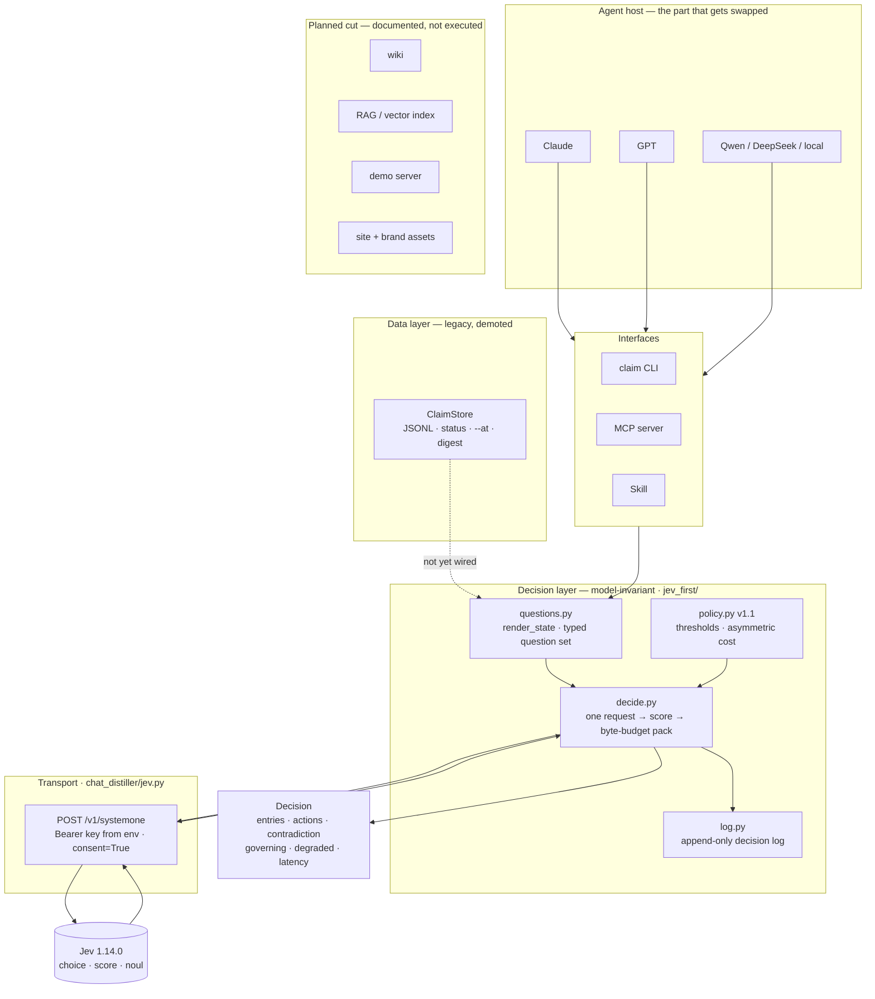
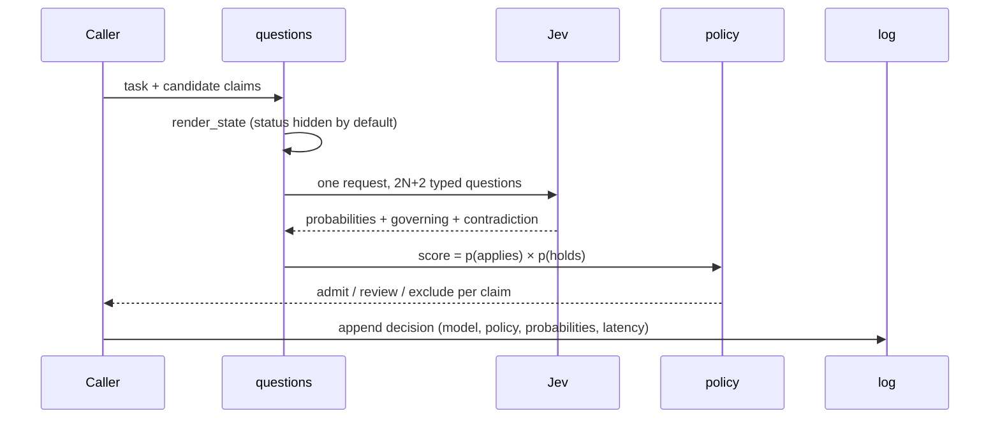
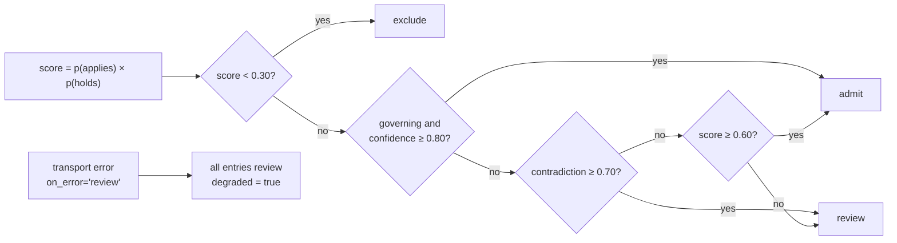

# Architecture and trust boundaries

**Updated** 2026-11-02. The project inverted its centre of gravity: judgment now
belongs to a typed question set and a deterministic policy, not to the ledger.
See [JEV-FIRST.md](JEV-FIRST.md) for why, and [DECISION.md](DECISION.md) for what
was withdrawn.

Dashed edges are **not wired yet**.

## 1. Current architecture

The swapped part is the agent host. The question set, the policy and the log stay
fixed, which is what makes "change models, keep memory" a structural property
rather than a promise.

## 2. Decision pipeline

`include_status=False` is the default: the model must judge from content, not from
a status field the legacy runtime already produced.

## 3. Policy state machine

Two invariants are encoded here:

- **Asymmetry.** Wrong suppression is silent; wrong retention is visible. So a
  contradiction forces `review`, never automatic `exclude`.
- **Outage is not evidence.** A transport failure fails open to `review`; a model
  that cannot answer must never look like a confident exclusion.

## 4. Measured constraints

| Constraint | Value | Source |
|---|---|---|
| Claims per request | ≤ 6 | 10 questions took 11.2 s once, 2.9 s another time |
| Pair-judgement latency | median 1,276 ms, max 7,274 ms | 30-pair run |
| Observed timeout | 1 in 30 (60 s) | same run |
| Transport failure policy | fail open to `review`, never `exclude` | added after that timeout |
| Probability reproducibility | decisions stable, values not | 0.89/0.63 vs 0.90/0.68 |

Jev is therefore **write-time and batch only**. It is permanently out of any
interactive read path at this latency.

## 5. Legacy layer (still present, off the decision path)

The original runtime remains in `chat_distiller/` and is not deleted:

| Object | Responsibility |
|---|---|
| `ClaimStore` (append-only JSONL) | Claim text, status, supersession chain, `--at` reconstruction, digest |
| Publish path | Deterministic extraction, explicit init/register, structural validation |
| Read path | Lexical ranking, byte-budgeted packet, status filtering |
| Derived views (notes, index, registry mirror) | Rebuildable projections, checked rather than trusted |
| Human / host agent | Semantic judgment and decisions about what to do next |

Two facts about it matter for the current design:

1. Its status filter is **not** used by `decide()`. The decision layer receives
   claim text only, so validity comes from model judgment rather than a label.
2. Its retrieval is **lexical**. That is the specific failure the 30-pair run
   targeted: `PostgreSQL is banned` vs `Use PostgreSQL` shares almost every token
   and means the opposite.

## 6. Naming layers: deliberate, not drift

| Layer | Name | Why it stays |
|---|---|---|
| Product | ClaimLedger | What the repository is called now |
| Package | `chat_distiller` | Import path used by every existing integration |
| Data home | `~/.chat-distiller` | Existing user data must not move |
| Entry points | `claim`, `carrytrace`, `chat-distiller` | Compatibility during migration |

Three names for one thing looks like indecision; it is a compatibility decision.
Renaming the package or the data home would break installed tooling and strand
existing ledgers.

## 7. What is deliberately absent

- No retrieval path calls Jev.
- No embeddings, no wiki, no third read path.
- No hosted service, no daemon, no cross-machine sync.
- The optional Jev adapter is the only network path, and it requires explicit consent.

[Back to README](../README.md)